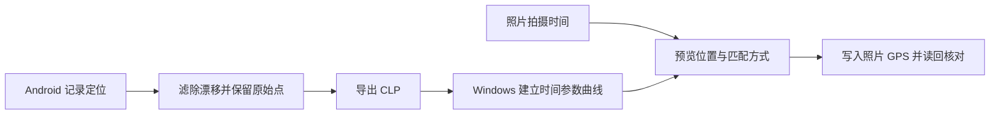
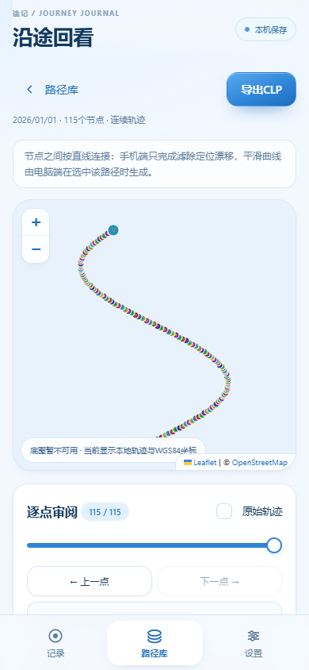
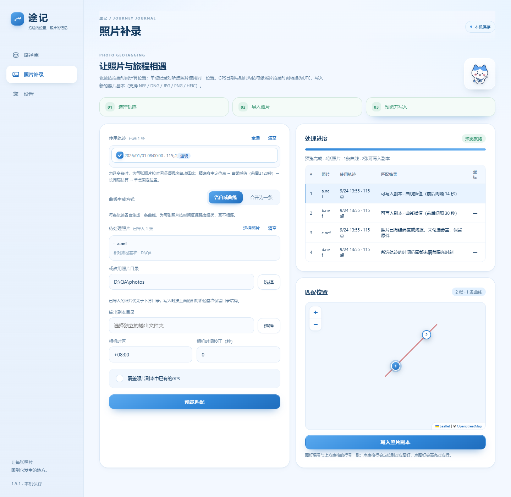
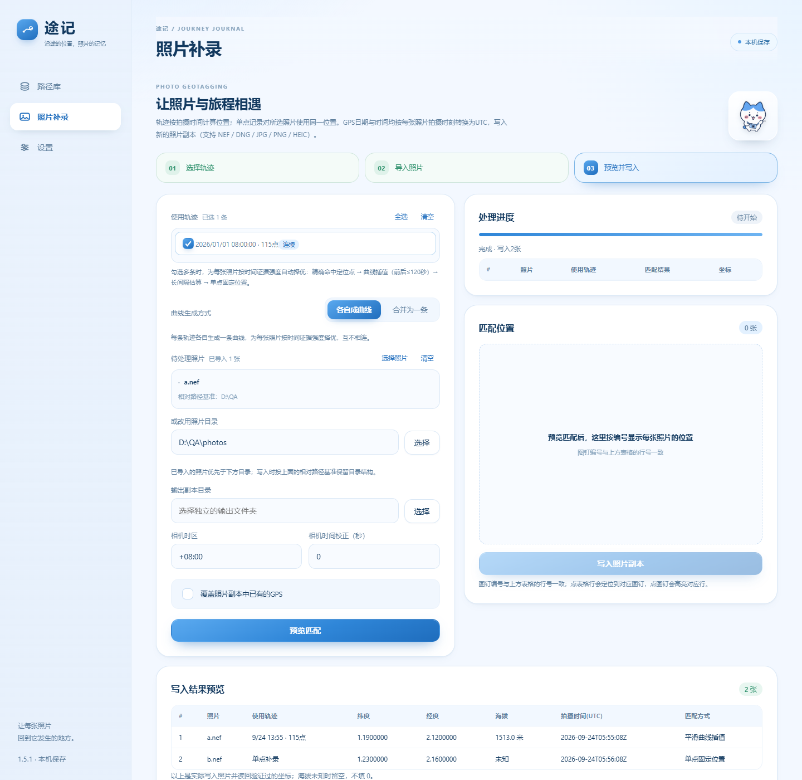
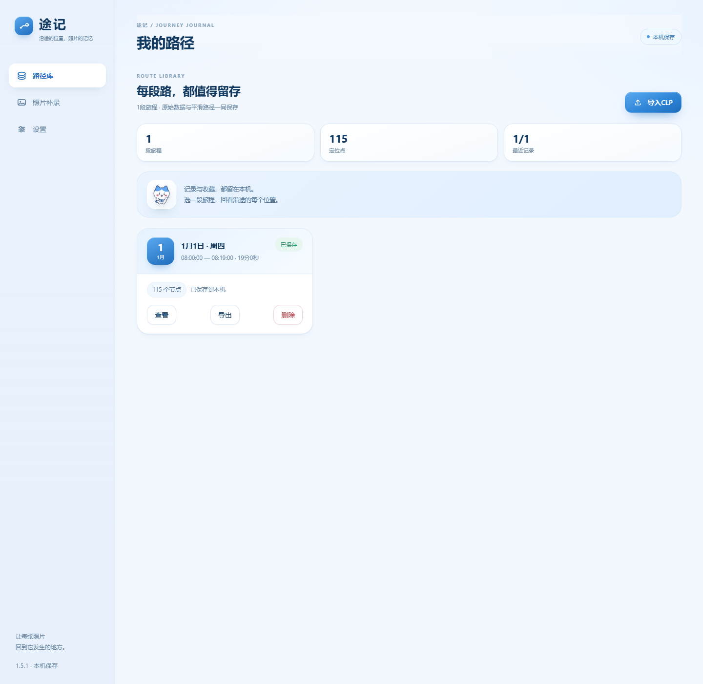
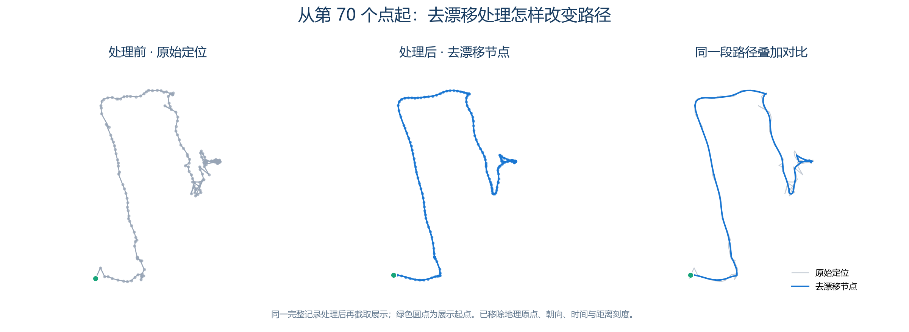
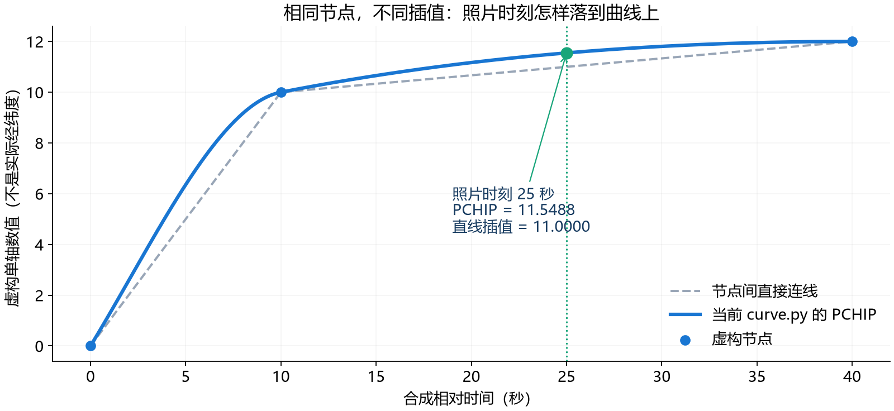
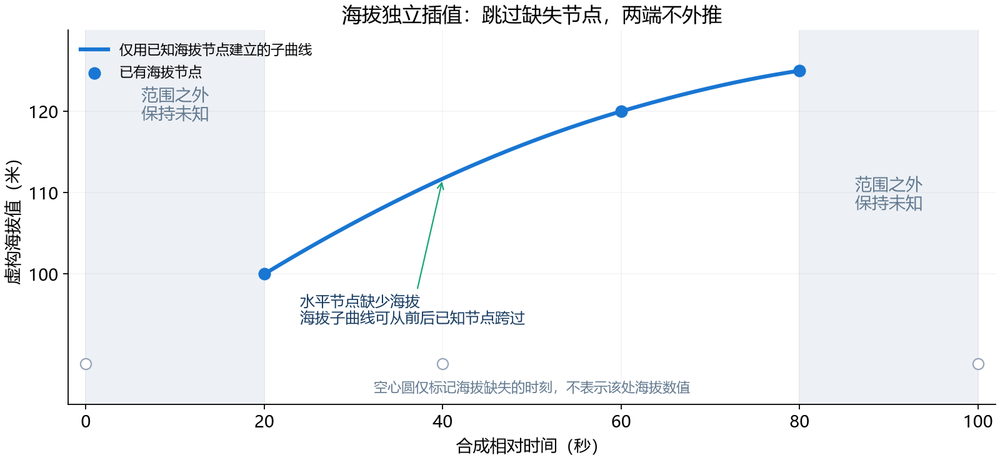

<div align="center">

# 途记 · Tuji

### 沿途的位置，照片的记忆。

用 Android 记录旅程，用 Windows 为照片补上拍摄位置。

**Android + Windows · 本机保存 · 多格式照片 GPS · 当前版本 1.5.1**

[下载安装包](https://github.com/ccl4-56-23-5/Tuji/releases/tag/v1.5.1) · [轨迹怎样计算](#轨迹怎样计算) · [算法详解与公式](docs/TRAJECTORY.md) · [构建源码](BUILD.md)

</div>

---

## 途记能做什么

拍照时，相机可能没有 GPS，但随身手机可以留下沿途的位置。途记把这两部分连接起来：**手机记录“什么时间在什么位置”，电脑读取“照片在什么时间拍摄”，再把匹配到的位置写进照片。**

外出前开始记录，结束后导出 `.clp` 轨迹；回到电脑导入轨迹和照片，检查时间、预览结果与地图，再执行写入。

| 场景 | 使用方式 |
| --- | --- |
| 散步、旅行、外出拍摄 | 连续记录，按每张照片的拍摄时间匹配位置 |
| 在同一地点拍摄多张照片 | 记录一个位置，在电脑上明确选择单点补录 |
| 一次拍摄对应多段行程 | 同时选择多条轨迹，分别匹配；也可主动合并成一条曲线 |
| 照片已经有 GPS | 预览中区分已有定位，按覆盖选项决定是否替换 |
| 想先核对再处理 | 查看逐张结果、匹配方式和编号图钉，然后写入 |



## 界面导览

图片来自 **1.5.1 的实际界面代码**，使用合成轨迹、虚构照片名和模拟桥接返回值；不是 Android 真机或 Windows EXE 的验收截图。取图时关闭了在线底图请求，因此地图中只展示本地轨迹和图钉。详见 [截图来源](docs/SCREENSHOTS.md)。

### Android：记录、保存、回看

<table>
<tr><th width="33%">记录沿途</th><th width="33%">我的路径</th><th width="33%">逐点回看</th></tr>
<tr>
<td></td>
<td></td>
<td></td>
</tr>
<tr><td>圆盘显示记录状态与时间，结束后保存旅程。</td><td>按旅程管理记录，查看时间和节点数，并导出 CLP。</td><td>按节点回看；手机端节点之间直连，电脑端负责插值曲线。</td></tr>
</table>

连续记录之外，手机还提供“记录一个位置，用于补录”。单点模式会明确保存为单点记录，电脑可将该位置用于所选照片；照片 GPS 时间仍取各自的拍摄时间。

### Windows：先看清匹配结果，再写入



照片补录分为 **选择轨迹 → 导入照片 → 预览并写入**。左侧设置轨迹、照片、输出目录、时区与时间修正；右侧显示处理结果和匹配位置，写入按钮位于地图下方。

- **照片与图钉对应**：表格和地图使用相同编号，点击表格行或图钉可联动高亮。
- **逐张说明结果**：可写入、已有 GPS 而跳过、时间范围不覆盖等情况分别提示。
- **修改后重新预览**：轨迹、照片或匹配参数变化后重新计算，避免沿用过时结果。
- **文件导入**：选择照片、选择目录，或把受支持的照片及 CLP 拖入窗口。

### Windows：查看写入后的坐标与匹配方式



结果表列出照片编号、所用轨迹、经纬度、海拔、拍摄时间（UTC）和匹配方式。海拔未知时保持未知，不填 `0`。这里展示的是模拟桥接返回的合成结果；实际程序会在写入后读回核对 GPS。

<details>
<summary><b>更多界面：电脑路径库与设置</b></summary>

#### 电脑路径库



轨迹导入后保存在本机路径库，可继续查看或用于照片匹配。

#### 电脑设置


设置中可以确认“新建副本 / 覆盖原始文件”等处理偏好。

</details>

## 轨迹怎样计算

**途记把“滤除定位漂移”和“在节点之间插值”分成两步。** 前者可以调整定位点，后者从已有节点计算照片时刻的位置；插值点不是真实新增的 GPS 观测。

| 数据 | 含义 | 由谁产生 |
| --- | --- | --- |
| `rawPoints` | 原始定位观测，保留时间与原始字段 | Android 采集 |
| `points` | 与原始点保持数量、时间对应的节点；水平方向经过漂移处理 | Android 停止记录后 |
| `curve` | 根据节点重建的时间参数曲线 `pchip-4d-v2` | Windows |
| 照片匹配点 | 在照片拍摄时刻对曲线求值，或明确使用单点 | Windows |

### 第一步：让定位节点少受漂移影响

Android 使用 `robust-stop-v2`。经纬度先转换为局部米制平面，在东西、南北两个方向分别做鲁棒迭代拟合：既参考定位精度，也约束速度变化；识别为静止的区间还会增加低速度约束，减轻人没动、定位却游走的现象。

它不是简单移动平均，也不是把所有点吸附到道路。原始点保存在 `rawPoints`，处理后的节点放在 `points`，并记录水平修正距离。具体权重、静止判据与迭代参数见 [第一步详解](docs/TRAJECTORY.md#2-第一步水平定位去漂移)。



这个例子先处理完整记录，再从第 70 个点（含）截取展示；Java 复算与 CLP 中保存的结果一致。灰色为原始节点连线，蓝色为去漂移节点连线，尚未做第二步插值。这里只展示匿名化路径形状，已去掉地图、地理坐标、朝向、时间和距离刻度；原文件与解密数据不上 GitHub。[查看局部放大及解释](docs/TRAJECTORY.md#25-真实记录示例从第-70-个点起)。

### 第二步：以时间为参数，做 PCHIP 保形三次插值

Windows 使用分段三次 Hermite 插值。时间是参数，纬度、短路径展开后的经度、海拔分别是坐标轴；“四维”指 **时间 + 三个空间坐标**。



对照片时刻 $t$，先找到相邻节点 $t_i \le t \le t_{i+1}$，令 $u=(t-t_i)/(t_{i+1}-t_i)$。每个坐标轴的计算形式相同：

$$
\begin{aligned}
y(t)={}&(2u^3-3u^2+1)y_i+(u^3-2u^2+u)h m_i\\
&+(-2u^3+3u^2)y_{i+1}+(u^3-u^2)h m_{i+1}.
\end{aligned}
$$

其中：

- $h=t_{i+1}-t_i$：区间的时间长度。
- $y_i$ 与 $y_{i+1}$：两端节点的坐标值。
- $m_i$ 与 $m_{i+1}$：两端节点的变化率。

**PCHIP 的关键是怎样选这些变化率**：同向变化时用相邻割线斜率的加权调和平均，遇到转折或平台时把内部斜率置零，端点另作限幅。这样各段通过节点，一阶导数连续，并保持各单轴数据的局部单调形状。它不保证二维轨迹不自交，也不做道路匹配。

图中的曲线直接调用本仓库 `curve.py` 求值，节点和时间完全虚构。公式的斜率推导、端点处理及一个可手算的数值例子见 [PCHIP 详解](docs/TRAJECTORY.md#4-pchip-插值的完整计算)。

### 海拔：缺失值不填零，已知区间内单独插值



电脑端先对已有海拔做独立的鲁棒处理，缺失海拔的节点仍保持缺失。随后只取海拔已知的节点，建立 `alt` 子曲线：中间缺失部分可在已知海拔之间计算，首末已知海拔之外不外推。

需要注意当前实现的一个细节：**照片精确命中节点时，匹配器直接返回该节点；若该节点海拔缺失，照片海拔仍为未知。** 非精确命中的插值分支才读取海拔子曲线。详见 [海拔处理与这一边界](docs/TRAJECTORY.md#5-海拔为什么单独处理)。

### 边界与多轨迹如何处理

| 情况 | 当前 1.5.1 的行为 |
| --- | --- |
| 相同时间有多个定位 | 照片匹配索引保留水平精度 `hacc` 较小的合格点 |
| 定位精度低或缺失 | 匹配索引仅使用 `hacc` 非空且不大于 100 米的节点 |
| 照片时刻在节点之间 | 用 PCHIP 计算；两端间隔超过 120 秒时标为“长间隔估算” |
| 照片在连续轨迹时间范围外 | 不外推，不自动拿最近点代替 |
| 跨越 ±180° 经线 | 先按短路径展开经度，求值后归一回 `[-180°, 180°)` |
| 多条轨迹各自成曲线 | 每张照片择优：精确节点 → 普通插值 → 长间隔估算 → 单点固定位置 |
| 同级多个候选 | 比较夹逼时间跨度、水平精度，最后按传入顺序稳定排序 |
| 主动合并轨迹 | 合并连续轨迹节点并重建曲线，单点不参与；段间大空档仍标估算 |

**120 秒是结果分类阈值，不是停止计算的门槛。** 当前版本会跨长空档插值，但标明“估算”；没有道路、运动模型或其他观测来证明空档中的真实行走路线。

匹配曲线会先过滤低质量点，而路径库回看曲线使用加载后的节点，所以两者的节点集合可能不同。地图折线还可能为显示而抽稀，照片坐标则直接对曲线求值。完整数据流、公式、源码入口和限制见 **[轨迹计算逻辑详解](docs/TRAJECTORY.md)**。

## 下载与安装

当前版本 **1.5.1**；Android 包名 `app.nefgpstrack`，版本码 **13**，工程最低版本 **Android 8.0（API 26）**。电脑端为 Windows 桌面程序，使用 WebView2 界面。

| 下载 | 用途 |
| --- | --- |
| [Android APK](https://github.com/ccl4-56-23-5/Tuji/releases/download/v1.5.1/NefGpsTrack-Android-1.5.1.apk) | 手机记录与导出轨迹 |
| **[Windows 安装器，推荐](https://github.com/ccl4-56-23-5/Tuji/releases/download/v1.5.1/NefGpsTrack-Setup-1.5.1.exe)** | 首次选择安装位置，已有安装按原位置升级 |
| [Windows 便携主程序](https://github.com/ccl4-56-23-5/Tuji/releases/download/v1.5.1/NefGpsTrack-Windows-1.5.1.exe) | 直接运行主程序或便携部署 |
| [发布源码 ZIP](https://github.com/ccl4-56-23-5/Tuji/releases/download/v1.5.1/Tuji-Source-1.5.1.zip) | 与 `v1.5.1` 标签对应的发布时源码快照 |
| [SHA256SUMS.txt](https://github.com/ccl4-56-23-5/Tuji/releases/download/v1.5.1/SHA256SUMS.txt) | 校验上述下载文件 |

最新图文文档随 `main` 更新；要同时获取当前文档与源码，可使用 **Code → Download ZIP** 或克隆仓库。

## 开始使用

### 1. 手机记录，导出轨迹

安装 APK，授予定位、通知等所需权限，在“记录”页选择节奏并开始记录。结束后保存，在“路径库”导出 `.clp`，通过自己选择的文件传输方式送到电脑。

锁屏记录前，按手机系统设置允许后台定位、自启动与适当的电池策略；相关入口位于设置页。后台表现取决于设备和系统，仍需真机验收。

### 2. 电脑导入，核对时间

安装 Windows 版，将 CLP 导入路径库。在“照片补录”中勾选轨迹，导入照片或选择照片目录，再设置输出目录、相机时区和已知的时钟修正量。

照片拍摄时刻来自 `DateTimeOriginal` 与亚秒信息；优先使用照片的 `OffsetTimeOriginal`，缺失时才使用界面时区。换算为 UTC 后再加上时间修正量。例如相机慢了 10 秒，应加 `+10` 秒。程序不会把文件导入时间或照片里已有的 GPS 定位时间当作快门时刻。

### 3. 预览，核对，再写入

点击“预览匹配”，检查逐张结果、跳过原因与地图图钉。确认轨迹及时间正确后，点击地图下方的写入按钮；完成后查看写入结果。

## 照片格式与处理方式

| 类型 | 后缀 |
| --- | --- |
| Nikon RAW | `.nef` |
| DNG | `.dng` |
| JPEG | `.jpg`、`.jpeg` |
| PNG | `.png` |
| HEIF / HEIC | `.heif`、`.heic` |

Windows 通过随程序附带的 ExifTool 读写 GPS，并检查扩展名与实际类型是否一致。当前多格式回归使用合成 DNG、JPG、PNG、HEIC 夹具；真实相机 DNG、手机 HEIC，以及第三方软件读取 PNG GPS 的兼容性仍待验证。

| 选项 | 行为 |
| --- | --- |
| 新建副本 | 输出到独立目录，保留相对目录结构 |
| 覆盖原始文件 | 在设置中主动切换，可配置独立备份目录 |
| 不覆盖已有 GPS | 已有经纬度或海拔的照片跳过 |
| 允许覆盖已有 GPS | 替换符合条件照片的定位，并读回核对 |

只有 GPS 版本号、没有经纬度和海拔的“空 GPS 信息”，不会被当作已有定位。结果在界面中显示，不额外生成 CSV 表格。

## 数据、升级与备份

Windows 数据随安装目录保存：

```text
<安装目录>/
  途记.exe
  data/
    路径库/          可读文件名的 CLP，另有 导出/ 子目录
    程序数据/        settings.json、安装信息、日志等
```

安装器检测到有效安装后按原位置升级，保留 `data/`。旧版用户目录的数据可迁移，旧目录保留；卸载提供是否保留数据的选择。完整安装、升级、迁移和卸载的人工验收状态见 [设备验收清单](sources/NefGpsTrack/1.5.1/qa/device_acceptance.md)。

轨迹库与照片处理在本机进行，地图底图使用 OpenStreetMap 在线瓦片。CLP 使用固定互通口令，**不提供用户独立口令的保密隔离**。公开仓库不包含原始轨迹文件、用户照片或发行签名材料。

## 常见问题

<details>
<summary><b>照片匹配不上，先检查什么？</b></summary>

先核对相机时区、时钟偏差和轨迹覆盖时间，再看预览中是否提示已有 GPS、低质量定位或文件类型不符。连续轨迹不会在时间范围之外自动匹配最近点。

</details>

<details>
<summary><b>没有连续轨迹，可以补一个固定位置吗？</b></summary>

可以。手机选择“记录一个位置，用于补录”，导出单点 CLP，再在电脑选择它。此模式明确让所选照片使用同一位置。

</details>

<details>
<summary><b>是否支持小米超级岛？</b></summary>

包含能力检测和通知适配入口，受系统协议、通知及焦点通知权限影响。实际岛上显示与锁屏后台存活尚未完成真机验收。

</details>

<details>
<summary><b>自己编译签名的 APK 能覆盖发行版吗？</b></summary>

只有兼容签名才能覆盖升级。仓库不含原发行签名材料；新签名 APK 不能直接覆盖原签名安装。详见 [构建说明](BUILD.md)。

</details>

## 源码与验证

```text
sources/NefGpsTrack/1.5.1/
  android/      定位服务、轨迹数据库、Android 应用和 Gradle Wrapper
  windows/      曲线、时间匹配、照片 GPS 写入与 ExifTool 分发包
  installer/    Windows 安装器
  shared/       双端共用界面、样式与图像
  qa/           合成夹具、协议向量与回归脚本
  CLP_FORMAT.md
  完整维护文档.md
docs/           算法详解、演示曲线与界面截图
build-android.ps1
```

[构建说明](BUILD.md) · [轨迹算法详解](docs/TRAJECTORY.md) · [版本说明](sources/NefGpsTrack/1.5.1/README.md) · [CLP 格式](sources/NefGpsTrack/1.5.1/CLP_FORMAT.md) · [完整维护文档](sources/NefGpsTrack/1.5.1/完整维护文档.md) · [公开源码说明](PUBLICATION.md)

轨迹算法、界面与安装包来自已归档的 **1.5.1**。公开源码将原固定互通口令改为本地配置读取，构建前须配置双端相同口令，详见 [BUILD.md](BUILD.md)；未重新构建现有安装包。核心回归、安装器、多格式、协议向量及模拟桥接界面的检查范围，见 [VALIDATION.md](VALIDATION.md)。
