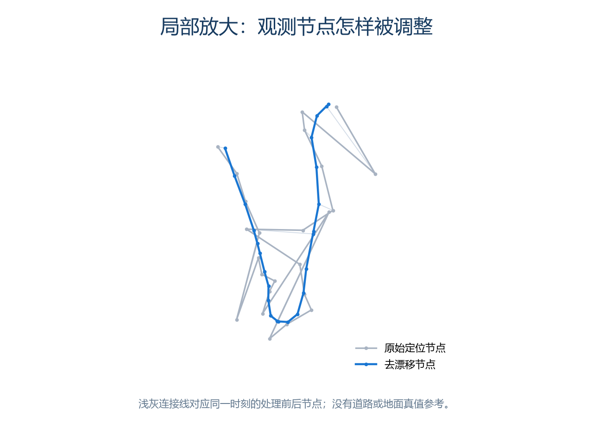

# 轨迹怎样从定位点变成照片位置

本文对应 **途记 1.5.1**。先说明原始数据、去漂移节点与插值点的区别，再对照源码写出计算公式。真实记录示例只公开匿名化轨迹图，公式演示另外使用虚构数据。

## 1. 两步计算，各自解决什么问题

| 阶段 | 输入 → 输出 | 目的 |
| --- | --- | --- |
| Android 采集 | 定位回调 → `rawPoints` | 保留原始时间、经纬度、海拔、水平精度、速度和定位来源 |
| 水平去漂移 | `rawPoints` → `points` | 在保留时间与点数对应关系的前提下，调整水平位置 |
| Windows 曲线 | 节点 → `curve` | 以时间为参数，计算节点之间的位置 |
| 照片匹配 | 拍摄时间 → 匹配点 | 对符合精度条件的节点建立索引，选择精确点、插值或单点 |

手机停止记录后使用 `robust-stop-v2` 处理水平位置，导出原始点与处理后节点，不导出插值曲线。电脑端重建 `pchip-4d-v2`，不信任 CLP 中历史版本携带的曲线系数。已经标记 `robust-stop-v1/v2` 的水平节点不重复去漂移；未识别该标记的旧 CLP 才用 Python 等价实现兜底。

去漂移会移动观测节点；插值通过输入节点并计算中间时刻。两步都不会增加真实观测，也不会自动匹配道路。

## 2. 第一步：水平定位去漂移

实现：[TrackSmoother.java](../sources/NefGpsTrack/1.5.1/android/app/src/main/java/app/nefgpstrack/TrackSmoother.java)；Python 兜底：[smoothing.py](../sources/NefGpsTrack/1.5.1/windows/smoothing.py) 的 `_fit`。

### 2.1 先在局部米制平面中计算

经度先做短路径展开，避免跨过 ±180° 时出现近 360° 跳变。以该批节点的平均纬度、平均展开经度为局部原点，近似换算为东西和南北两个方向的米制坐标；使用地球半径常数 `6371008.8 m`，经度方向乘平均纬度的余弦。

这是局部平面近似。长距离、近极区或复杂跨界轨迹不能据此获得全球测地精度保证。

### 2.2 定位精度决定数据权重

每个点的误差尺度取：

$$
\sigma_i=\max(3,\mathrm{hacc}_i)\,c_i,
\qquad c_i=\begin{cases}1,&\text{GPS}\cr4,&\text{其他来源}\end{cases}
$$

缺失水平精度时使用 50 米的兜底输入。两个轴分别迭代。设原始该轴坐标为 $y_i$，当前拟合值为 $x_i$，标准化残差和迭代权重是：

$$
r_i=\frac{x_i-y_i}{\sigma_i},\qquad
w_i=\frac{1}{\sigma_i^2\sqrt{1+r_i^2}}.
$$

因此，精度较差的点权重较低，偏离当前拟合很大的点也会被降权。这是鲁棒迭代重加权最小二乘（IRLS）；它没有把离群点无条件删除。

### 2.3 约束速度变化，降低锯齿抖动

相邻时间差 $\Delta_i$ 在这里使用**秒**，最低按 `0.05 s` 计算。对内部节点，给前后速度差加入二次惩罚：

$$
\left[\frac{1}{q_i}\left(\frac{x_{i+1}-x_i}{\Delta_i}-\frac{x_i-x_{i-1}}{\Delta_{i-1}}\right)\right]^2,
\qquad q_i=0.035\max\left(1,\frac{\Delta_{i-1}+\Delta_i}{2}\right).
$$

这使拟合在跟随观测与减少速度突变之间折中。它是当前版本的工程正则化，不能理解为已知人体加速度或经过标定的误差概率模型。

### 2.4 识别静止段，增加低速度约束

当前静止段判据同时要求：GPS 速度在 `0–0.3 m/s`，至少 4 个符合条件的 GPS 观测，首尾跨度至少 40 秒，并且相对坐标中位数中心的最大散布不超过 `max(50 m, 2 × 该段 σ 的中位数)`。非 GPS 观测不参加速度候选判定；被标记区间内的相邻步长会加入约束。

静止区间的惩罚形式为：

$$
\left(\frac{x_{i+1}-x_i}{q_i^{stop}}\right)^2,
\qquad q_i^{stop}=\max(0.2,0.025\Delta_i).
$$

它鼓励区间内少移动，并非强制所有点重合。两轴都通过带状 Cholesky 解线性系统，最多 60 次迭代；水平轴最大更新小于 `10^{-5} m` 时提前结束。这个数值收敛阈值不是 GPS 精度承诺。

### 2.5 真实记录示例：从第 70 个点起

这里先把完整记录交给未经修改的 1.5.1 Java 去漂移实现，再从原始点序号 **70（含）** 截取到末尾展示。复算结果与 CLP 中保存的去漂移节点一致。这样保留了真实程序处理时的上下文，而不是在截取起点重新施加一组边界条件。

灰色是原始节点及其连线，蓝色是去漂移后的节点及其连线。这里**尚未叠加 PCHIP 插值**，因此看到的变化来自第一步。局部较突兀的游走和折返得到一定抑制，整体行程形状仍被保留；留下的弯折也说明算法没有把路径强制拉直。

本例按同一套判据复核，确实触发了静止段约束。因此，蓝线包含精度权重、鲁棒降权、速度变化惩罚和静止低速惩罚的共同作用；没有分别关闭这些项做消融对照，不能仅凭图给每项分配效果贡献。

这组图没有地面真值或独立高精度参考，能展示“算法怎样改变观测”，不能证明蓝线就是真实行走路线，也不能从线条更顺推导出绝对定位精度提高。

**公开范围**：真实记录仅上传这两幅栅格对比图；两条路径使用同一个平移、旋转和统一缩放变换，移除地理原点、经纬度、地图、朝向、时间和距离刻度。CLP、解密文件、逐点表格、变换参数及原始地点信息只保存在本机。

## 3. 建立照片匹配曲线前，还要筛选节点

[time_match.py](../sources/NefGpsTrack/1.5.1/windows/time_match.py) 的 `build_track_index`：

1. 只接收 `hacc` 非空且不大于 **100 米**的节点。
2. 同一时间的重复节点，保留 `hacc` 更小者。
3. 按 UTC 毫秒时间排序，再调用 `build_curve`。

路径库回看的加载曲线与照片匹配索引不是完全相同的调用路径：匹配索引有上述精度筛选，可能留下更少节点。因此不能假定回看折线上的每个节点都会参与照片位置计算。

## 4. PCHIP 插值的完整计算

实现：[curve.py](../sources/NefGpsTrack/1.5.1/windows/curve.py) 的 `slopes`、`build_curve`、`evaluate`。这是本仓库的直接实现，不依赖 SciPy 运行；PCHIP 的方法说明可参照 [SciPy 官方文档](https://docs.scipy.org/doc/scipy/reference/generated/scipy.interpolate.PchipInterpolator.html)。

### 4.1 时间与三个坐标轴

输入节点为 $(t_i,\phi_i,\lambda_i,z_i)$。时间是 UTC **毫秒**，分别拟合纬度、展开后的经度和海拔。按坐标轴保形不等同于在球面上按最短测地线运动，也不保证整条二维曲线没有自交。

对任一轴记坐标值为 $y_i$，定义区间长度和割线斜率：

$$
h_i=t_{i+1}-t_i,\qquad d_i=\frac{y_{i+1}-y_i}{h_i}.
$$

### 4.2 内部节点的导数

如果相邻割线异号，或任一为零，则 $m_i=0$。这会在转折点或平台边缘抑制不必要的冲过头。

若相邻割线同号，则使用加权调和平均：

$$
m_i=\frac{w_1+w_2}{w_1/d_{i-1}+w_2/d_i},\qquad
w_1=2h_i+h_{i-1},\quad w_2=h_i+2h_{i-1}.
$$

权重包含真实时间间隔，所以不要求等间隔采样。

### 4.3 两端的导数

只有两个节点时，两端导数都取唯一割线斜率，所得三次表达式退化为直线。三个以上节点时，左端候选导数为：

$$
v=\frac{(2h_0+h_1)d_0-h_0d_1}{h_0+h_1}.
$$

如果 $vd_0\le0$，将端点导数设为零；如果两段割线异号且 $|v|>3|d_0|$，限幅到 $3d_0$；其余使用 $v$。右端对称处理。

### 4.4 找到照片所在区间，再代入 Hermite 多项式

二分查找得到 $t_i\le t\le t_{i+1}$，设 $u=(t-t_i)/h_i$，则：

$$
\begin{aligned}
y(t)={}&(2u^3-3u^2+1)y_i+(u^3-2u^2+u)h_i m_i\\
&+(-2u^3+3u^2)y_{i+1}+(u^3-u^2)h_i m_{i+1}.
\end{aligned}
$$

曲线通过输入节点，节点处一阶导数连续，二阶导数可以不连续。纬度、展开经度与海拔子曲线分别使用同一求值形式。求值范围之外返回未知，不做连续轨迹外推。

### 4.5 一个可复算的数值例子

取虚构的单轴节点：时间为 `0、10、40 秒`，对应数值为 `0、10、12`。内部节点变化率约为 `0.1463414634 单位/秒`，右端为零。在 **25 秒**求值时，$u=0.5$，线性插值为 `11`，当前实现的 PCHIP 结果为 **11.5487804878**。

这个结果来自相邻区间斜率的共同约束，不能用“在两点之间按时间比例画直线”代替。它是纯数值演示，不含真实地点或距离数据。

### 4.6 经度跨界

例如从 `179.9°` 到 `-179.9°`，先展开为 `179.9° → 180.1°`，避免错误地跨越几乎整个地球。求值后再归一到 `[-180°,180°)`。

## 5. 海拔为什么单独处理

电脑端 `smooth_altitude` 只处理已有海拔的节点，少于三个已知海拔时原样返回。已知海拔噪声尺度根据绝对二阶差分的中位数估计：

$$
\sigma_z=\mathrm{clip}_{[1,30]}\left(\frac{1.4826}{\sqrt6}\,\mathrm{median}\{|z_{i+1}-2z_i+z_{i-1}|\}\right).
$$

样本不足或中位数不为正时取 5 米。该规则是工程估计，不是由设备校准得到的真实噪声。随后使用同类鲁棒重加权和速度变化惩罚，海拔惩罚系数为 `0.05`；最多 60 次，更新小于 `10^{-4} m` 时停止。

缺失值在这一步仍为缺失。`curve.py` 另外提取所有海拔已知节点建立 `alt` 子曲线，中间无海拔的水平节点不会截断这条子曲线。首个和末个已知海拔之外不外推；只有一个已知海拔时，子曲线仅在那个时刻有值。

**精确节点与插值分支的区别**：`match_track` 精确命中节点时，直接返回该 `TrackPoint`。如果其海拔是空值，照片海拔保持未知；非精确命中时，才使用 `evaluate` 返回的海拔子曲线结果。因此，单独调用曲线求值和执行精确节点匹配，不一定得到相同的缺失海拔行为。

海拔子曲线相邻已知节点的时间跨度可能比水平节点跨度更大；当前“长间隔估算”分类仅依据水平匹配节点的间隔，没有单独的海拔空档等级。

## 6. 怎样把照片时间变成查询时间

使用 `DateTimeOriginal`，结合 `SubSecTimeOriginal` 的亚秒信息。优先采用 `OffsetTimeOriginal`；缺少时使用界面设置的相机时区。先换算 UTC，再加时间校正秒数，最终四舍五入为 UTC 毫秒。

例如相机时钟慢 10 秒，修正量应为 `+10` 秒；快 10 秒则为 `-10` 秒。照片里已有的 GPS 时间可能早于快门时刻，不能用它代替拍摄时间。

## 7. 长空档、范围外、多轨迹与单点

| 场景 | 方法与边界 |
| --- | --- |
| 精确命中 | 返回该处理后节点，标记 `exact`；不是返回原始 `rawPoints` |
| 两端间隔 ≤120 秒 | 曲线求值，标记 `interpolated` |
| 两端间隔 >120 秒 | 仍求值，但标记 `curve-long-gap`，没有空档内的真实观测 |
| 连续轨迹范围外 | 返回无法匹配，不使用最近点兜底 |
| 单点记录 | 明确选中后可用于任意照片时刻，位置不随时间改变 |

`120 秒` 是分类阈值，不是硬截断。合并模式把连续轨迹的节点按时间合并，排除单点，同一时间择优，再重建曲线；两段之间的空档不会自动补出观测。

各自成曲线时，每张照片按 `(方法优先级, 两端时间跨度, hacc, 传入顺序)` 择优。方法顺序为精确命中、普通插值、长间隔估算、单点。插值结果的 `hacc` 取两端较大值，是保守字段继承，不是计算得到的位置置信区间。单点候选之间当前不按记录时刻距离排序。

源码中仍保留 `MAX_NEAREST_AGE_MS` 等历史参数，但当前 `match_track` 没有“超出范围就找最近点”的执行分支；不能依据常量名字推断实际功能。

## 8. 地图连线不等于照片计算本身

手机回看按节点直连。电脑曲线显示可使用 Hermite 求值，但照片匹配始终直接查询曲线，不会在地图截图或屏幕像素上取点。供照片匹配地图显示的折线最多单条 4000 点、合计 12000 点，超过时为显示而抽稀；显示抽稀不会把照片计算改成对抽稀点做线性插值。

## 9. 阅读源码与重现

| 入口 | 对应内容 |
| --- | --- |
| [TrackDb.java](../sources/NefGpsTrack/1.5.1/android/app/src/main/java/app/nefgpstrack/TrackDb.java) | 原始点、去漂移节点及 CLP 载荷 |
| [TrackSmoother.java](../sources/NefGpsTrack/1.5.1/android/app/src/main/java/app/nefgpstrack/TrackSmoother.java) | 水平去漂移与静止段约束 |
| [smoothing.py](../sources/NefGpsTrack/1.5.1/windows/smoothing.py) | 旧 CLP 兜底、海拔处理与加载曲线 |
| [curve.py](../sources/NefGpsTrack/1.5.1/windows/curve.py) | PCHIP 斜率、经度展开与海拔子曲线 |
| [time_match.py](../sources/NefGpsTrack/1.5.1/windows/time_match.py) | 精度筛选、照片时间与曲线匹配 |
| [batch.py](../sources/NefGpsTrack/1.5.1/windows/batch.py) | 多轨迹排序、合并及显示折线 |
| [render-algorithm-demos.py](render-algorithm-demos.py) | 只用虚构节点重现两幅插值/海拔演示图 |

真实记录的 CLP、解密数据、地点与图形变换参数不在公开仓库中。匿名化图可以帮助理解处理效果，不能作为已完成真机精度标定或道路真值验收的证据。
